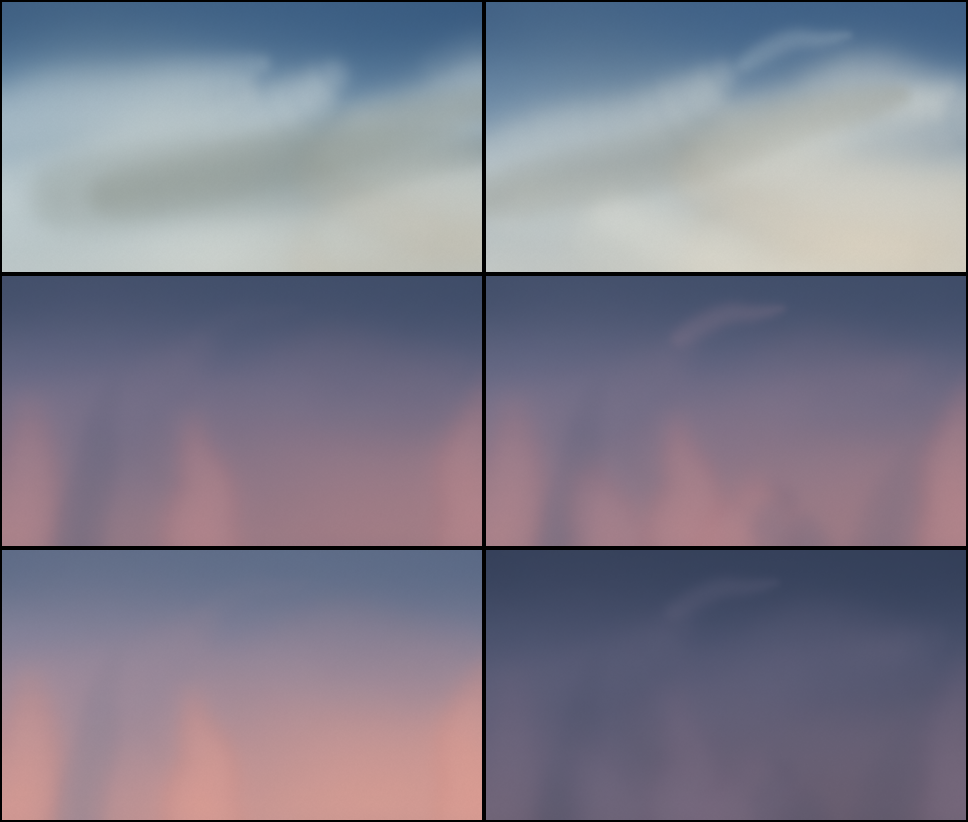

# Skytone

The sky over anywhere, at any hour. Skytone paints the real sky for a place and a moment as soft watercolour, from the sun's position and the live forecast. It's free, open source, and runs at [skytone.site](https://skytone.site).



This repository holds two things:

- **[`skytone`](packages/skytone)**, the engine, published to npm. A small TypeScript package with no dependencies that puts a living sky behind any interface.
- **[Studio](apps/studio)**, the web app at skytone.site. Pick a place, drag through the day, look up to sixteen days ahead, and export PNG, JPG, SVG or MP4 at any size.

## Use the engine

```bash
npm install skytone
```

```ts
import { SkyRenderer, skyAt, presetConditions } from 'skytone';

const sky = new SkyRenderer(canvas);
const { plate } = skyAt({ latitude: 19.08, longitude: 72.88, time: Date.now(), conditions: presetConditions('partly') });
sky.setPlate(plate);
sky.start();
```

The [package README](packages/skytone/README.md) covers the live forecast, React, and the full API.

## Develop

Requires Node 22 or newer.

```bash
npm install
```

```bash
npm run dev
```

| Script | What it does |
| --- | --- |
| `npm run dev` | Studio at http://localhost:5173, built against the engine's source. |
| `npm test` | Engine tests: sunrise and sunset against published times, determinism, palettes, SVG output. |
| `npm run typecheck` | Both packages. |
| `npm run build` | The engine to `packages/skytone/dist`, Studio to `apps/studio/dist`. |

To check the look by eye, `packages/skytone/scripts/contact-sheet.ts` paints a grid of hours and conditions as raw plates for ffmpeg to upscale.

## Deploy Studio

Studio is a static site on Firebase Hosting, with no backend.

```bash
firebase login
```

```bash
firebase use --add
```

```bash
npm run deploy
```

`firebase.json` sets the cache headers and a Content Security Policy that allows network calls only to Open-Meteo. If you point Studio at another weather provider, add its origin to `connect-src`.

## Credits

- Inspired by [Abidur Chowdhury's post](https://x.com/Abidur_C/status/2110397997536420187) on the skies in Hark Pro.
- Weather and place search: [Open-Meteo](https://open-meteo.com/), CC BY 4.0. Its free API is for non-commercial use.
- Sun and moon formulas follow [SunCalc](https://github.com/mourner/suncalc) by Vladimir Agafonkin.
- The home page demo uses the [Stageshow](https://github.com/benjitaylor/skills) kit by Benji Taylor (MIT); see `apps/studio/src/stage/kit`.
- Typeset in [Geist](https://vercel.com/font) Sans and Mono (SIL Open Font License).

## License

[MIT](LICENSE)
